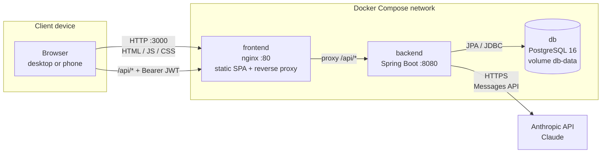
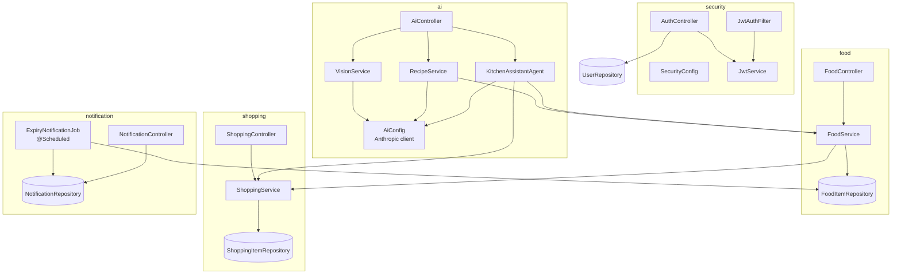
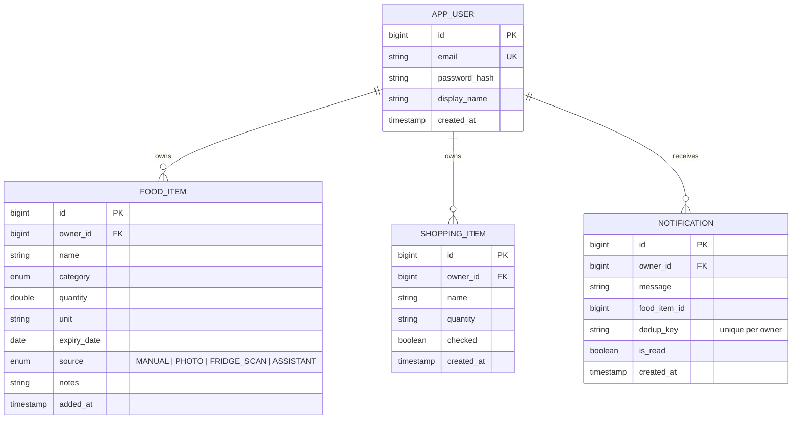
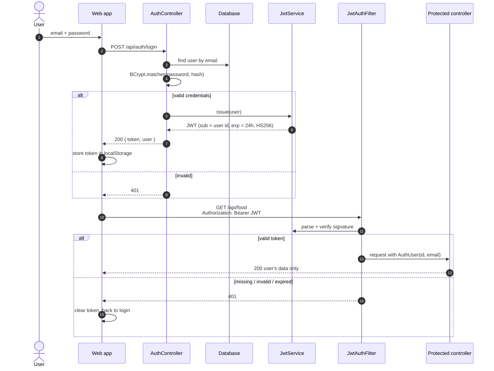
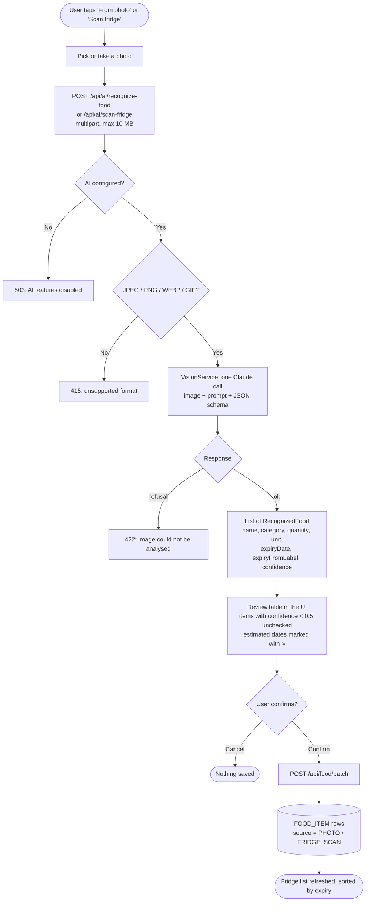
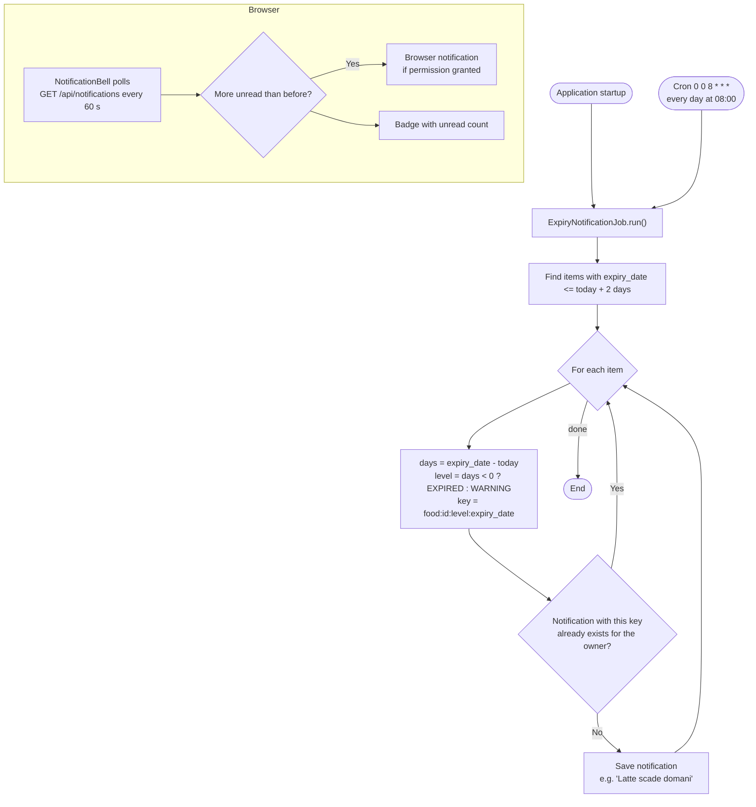
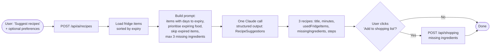
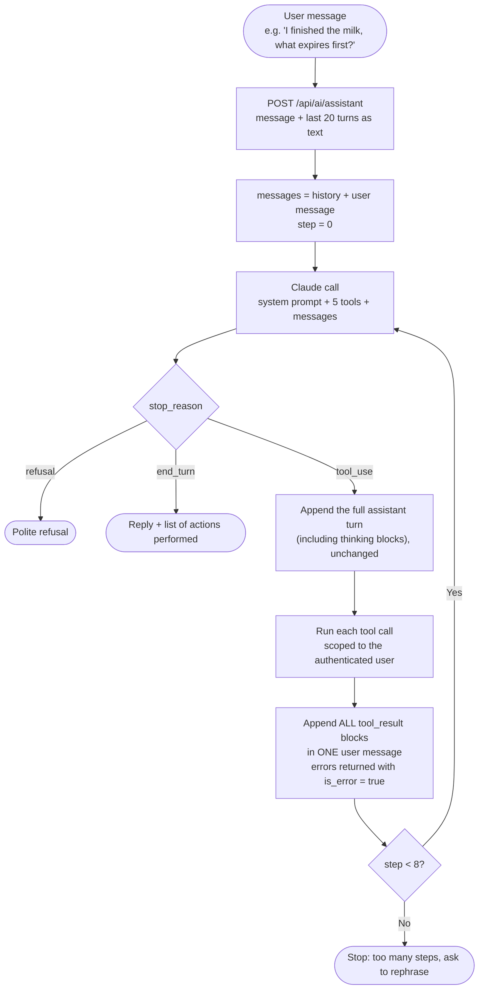
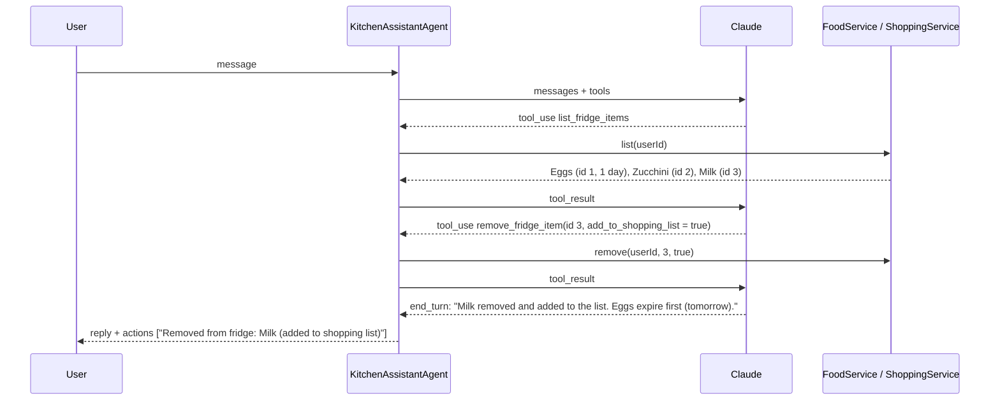
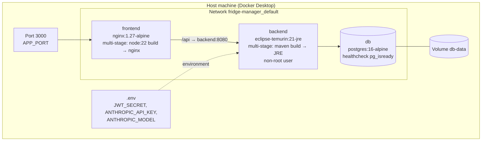

# Fridge Manager — Architecture

This document describes how Fridge Manager is built and how its main flows work.
Diagrams use [Mermaid](https://mermaid.js.org/) and render directly on GitHub and in IntelliJ.

## 1. Overview

Fridge Manager is a web application for tracking what is in your fridge, getting warned before food expires, keeping a shopping list and getting recipe suggestions. It uses Claude (Anthropic API) to recognise food from photos, suggest recipes and power a kitchen assistant that can act on your data.

| Layer | Technology |
|---|---|
| Frontend | React 18, TypeScript, Vite, React Router (responsive, works in mobile browsers) |
| Web server / reverse proxy | nginx (serves the built SPA, proxies `/api` to the backend) |
| Backend | Spring Boot 3.5, Java 21, Spring Web, Spring Security, Spring Data JPA |
| Authentication | Stateless JWT (HS256, `jjwt`), passwords hashed with BCrypt |
| Database | PostgreSQL 16 (Docker) or H2 file database (local development) |
| AI | Anthropic Java SDK, default model `claude-haiku-5-5` (configurable) |
| Packaging | Docker Compose: `frontend`, `backend`, `db` |

## 2. System architecture

Only the nginx container is published on the host (port `3000` by default, `APP_PORT`). The backend and the database are reachable only inside the Compose network. Because the SPA and the API share the same origin, the browser makes no cross-origin requests.

### Backend modules

| Package | Responsibility |
|---|---|
| `security` | Registration, login, JWT issuing and validation, filter chain, CORS |
| `user` | `User` entity and repository |
| `food` | Fridge items: CRUD, sorting by expiry, expiry status |
| `shopping` | Shopping list: add (with de-duplication), check, delete |
| `notification` | Daily expiry job and the notification API |
| `ai` | Photo recognition, recipe suggestions, kitchen assistant agent |
| `config` | Typed configuration (`AppProperties`), API error handling |

## 3. Data model

Every query is scoped by `owner_id`: a user can never read or modify another user's data. A request for someone else's item returns `404`, which does not reveal whether the item exists.

The schema is created by Hibernate (`ddl-auto: update`). For production, versioned migrations (Flyway or Liquibase) are recommended.

## 4. Authentication

Authentication is stateless. The server keeps no sessions: every request carries a signed JWT.

- Passwords are stored as BCrypt hashes.
- Tokens are signed with `JWT_SECRET` (at least 32 bytes) and expire after 24 hours (`app.jwt.expiration-minutes`). Changing the secret invalidates every token.
- CSRF protection is disabled because the API uses no cookies, only the `Authorization` header.
- Only `/api/auth/register` and `/api/auth/login` are public.

## 5. Main flows

### 5.1 Adding food from a photo (single item or whole fridge)

AI results are **never saved automatically**: the user reviews and corrects them first.

The prompts differ by mode:

- **Single item**: read the printed date ("da consumarsi entro", "exp", "best before"…). If only month and year are printed, use the last day of the month. If the date cannot be read, leave it empty instead of guessing.
- **Fridge scan**: list the items that can be identified with reasonable confidence. For fresh food without a visible date, estimate a cautious expiry date (`expiryFromLabel = false`).

### 5.2 Expiry notifications

This flow is deterministic and does not use AI.

The `dedup_key` makes the job idempotent: running it several times creates no duplicates. Because the key includes the expiry date, editing an item's date produces a new warning. The key also includes the level, so an item that goes from "expiring" to "expired" gets a second, different warning.

### 5.3 Recipe suggestions

### 5.4 Kitchen assistant (AI agent)

The assistant is the only part of the system built as an agent. The model decides which tools to call, and in which order, to satisfy an open-ended request.

| Tool | Effect |
|---|---|
| `list_fridge_items` | Returns the user's items with id, quantity, expiry date and days to expiry |
| `add_fridge_item` | Adds an item (`source = ASSISTANT`) |
| `remove_fridge_item` | Removes an item by id, optionally adding it back to the shopping list |
| `list_shopping_list` | Returns the shopping list |
| `add_to_shopping_list` | Adds one or more items, skipping duplicates still to be bought |

Example trace for *"I finished the milk, put it back on the list. What expires first?"*:

Safeguards:
- Every tool receives the `userId` from the JWT, never from the model.
- At most 8 model calls per request.
- Tool errors go back to the model as `is_error` results instead of failing the request.
- The system prompt tells the model to ask for clarification before removing an ambiguous item.

## 6. Where AI is used, and why

The guiding rule is to use the simplest approach that works.

| Feature | Approach | Rationale |
|---|---|---|
| Food photo recognition | Single call, image input, structured output | Well-defined task (image in, list out); an agent would only add cost and latency |
| Fridge scan | Single call, image input, structured output | Same as above, with a different prompt |
| Recipe suggestions | Single call, structured output | The fridge content is small and fits in the prompt |
| Kitchen assistant | **Agent** with tool use (manual loop) | Open-ended requests that need several steps and actions chosen by the model |
| Expiry notifications | **No AI** | A date comparison: deterministic, free and testable |

Implementation notes:
- **Structured outputs**: Java records in `AiModels` (with `@JsonPropertyDescription`) are turned into a JSON schema by the SDK. The response is validated against the schema and parsed into typed objects, so no manual JSON parsing is needed.
- **Model choice**: `ANTHROPIC_MODEL` (default `claude-opus-5-5`; the Docker setup uses `claude-haiku-5-5`). Haiku 5.5 was tested on all three AI features and handles them correctly at a fraction of the cost.
- **Refusal fallback**: on models that support it (Opus 5.x, Sonnet 5.5, Fable 5.1), requests enable the server-side fallback, so a safety refusal is retried on a fallback model. Haiku does not support it, so `AiConfig.applyFallback` adds the parameter only when it is supported.
- **Graceful degradation**: without `ANTHROPIC_API_KEY`, AI endpoints return `503` and the UI disables the AI buttons. Everything else keeps working.

## 7. Deployment

- Start order: `db` (must be healthy) → `backend` → `frontend`.
- nginx forwards `Host` with the port (`$http_host`), so Spring treats requests as same-origin whatever address is used (`localhost`, LAN IP).
- nginx allows uploads up to 12 MB and a 300 s read timeout for slow AI calls.
- Secrets live only in `.env`, which is git-ignored and is not copied into the images.

### Configuration

| Variable | Default | Purpose |
|---|---|---|
| `JWT_SECRET` | required in Docker | HMAC key for signing tokens |
| `ANTHROPIC_API_KEY` | empty | Enables the AI features |
| `ANTHROPIC_MODEL` | `claude-opus-5-5` | Claude model used by all AI features |
| `DB_PASSWORD` | `fridge` | PostgreSQL password |
| `APP_PORT` | `3000` | Port published on the host |
| `app.expiry.warning-days` | `2` | How many days ahead to warn |
| `app.expiry.cron` | `0 0 8 * * *` | When the expiry job runs |

## 8. REST API

| Method | Path | Auth | Description |
|---|---|---|---|
| POST | `/api/auth/register` | – | Create an account → `{ token, user }` |
| POST | `/api/auth/login` | – | Log in → `{ token, user }` |
| GET | `/api/auth/me` | JWT | Current user |
| GET | `/api/food` | JWT | Fridge items, sorted by expiry |
| POST | `/api/food` | JWT | Add an item |
| POST | `/api/food/batch` | JWT | Add several items (after photo review) |
| PUT | `/api/food/{id}` | JWT | Update an item |
| DELETE | `/api/food/{id}?addToShopping=` | JWT | Remove an item, optionally adding it to the shopping list |
| GET / POST | `/api/shopping` | JWT | List or add shopping items |
| PATCH / DELETE | `/api/shopping/{id}` | JWT | Update or delete a shopping item |
| DELETE | `/api/shopping/checked` | JWT | Remove items already bought |
| GET | `/api/notifications` | JWT | `{ unread, items }` |
| POST | `/api/notifications/{id}/read`, `/read-all` | JWT | Mark as read |
| GET | `/api/ai/status` | JWT | `{ enabled }` |
| POST | `/api/ai/recognize-food` | JWT | Multipart `photo` → recognised items |
| POST | `/api/ai/scan-fridge` | JWT | Multipart `photo` → recognised items |
| POST | `/api/ai/recipes` | JWT | `{ preferences }` → 3 recipes |
| POST | `/api/ai/assistant` | JWT | `{ message, history }` → `{ reply, actions }` |

Errors use the Spring `ProblemDetail` format (`detail` holds a user-facing message).

## 9. Known limitations and next steps

- **Browser notifications** need HTTPS (and, on iPhone, the web app added to the Home Screen). On plain HTTP over the LAN, warnings are visible only in the in-app bell. Next step: HTTPS and a PWA manifest, then Web Push (VAPID).
- **iPhone app**: the stateless JWT API is ready for a native or Expo / React Native client.
- **Schema migrations**: replace `ddl-auto: update` with Flyway.
- **Shared fridge**: households with several members.
- **Barcode scanning** (Open Food Facts) as a free, deterministic alternative to AI for packaged products.
- **Assistant history** is kept in the browser and sent as plain text, so it is lost on page reload.
